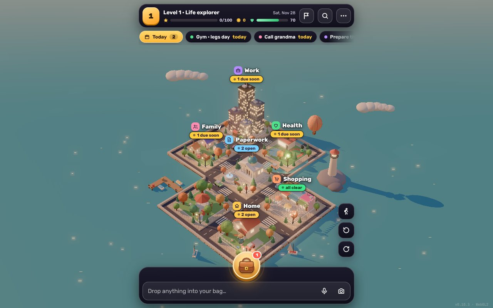
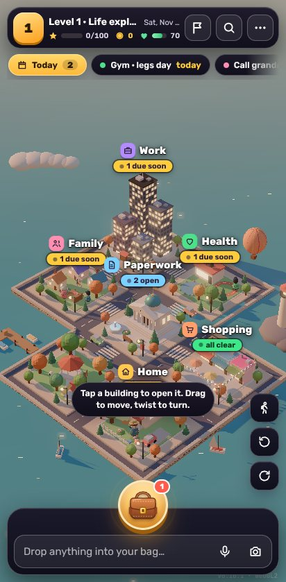
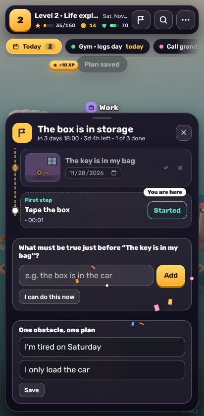
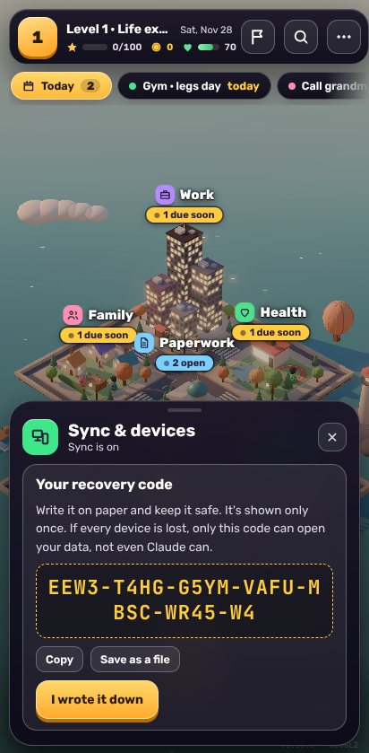
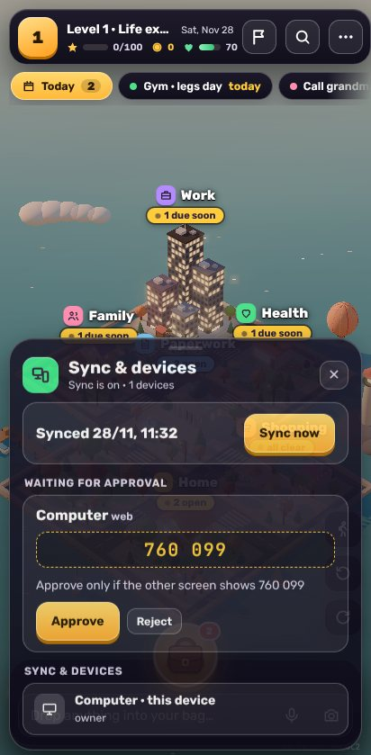
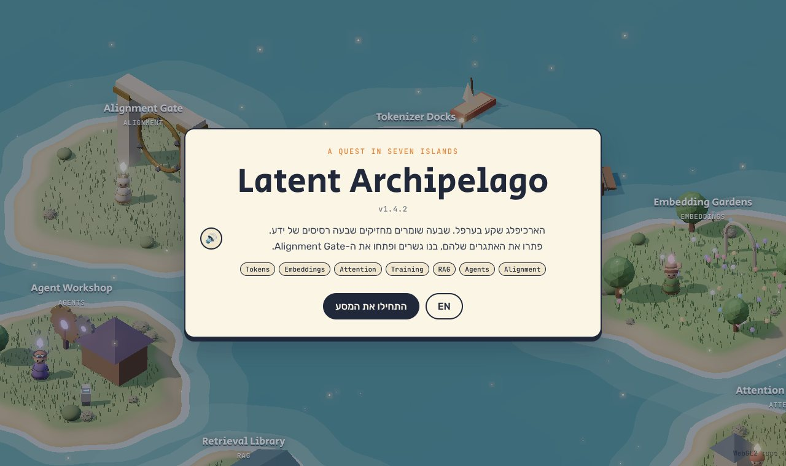

# byClaudePlatformPublic

Two products in one repository, both built with three.js (WebGPU, with a WebGL2 fallback):
**Life Archipelago**, a life organizer you play as a small city, and **Latent Archipelago**, a short 3D quest about AI concepts.

**▶ Open it: https://ranairan.github.io/byClaudePlatformPublic/** (the site opens Life Archipelago)

| | Link |
|---|---|
| Life Archipelago (web) | https://ranairan.github.io/byClaudePlatformPublic/life/app/ |
| Latent Archipelago (quest) | https://ranairan.github.io/byClaudePlatformPublic/quest/ |
| Android apps (APK) | [Releases](https://github.com/ranAIran/byClaudePlatformPublic/releases): `life-archipelago.apk` and `latent-archipelago.apk` |

## Life Archipelago

A second brain and life organizer shaped like a city at golden hour. Each life area is a district: Home, Family, Paperwork, Work, Health, Shopping, plus your own. A district shows how it's doing: scaffolding and a flickering lamp when something is overdue, festive lights when everything is done.



<p>
  
  
  
</p>

- **Capture anything** into the bag by typing, voice, photo, document scan or share. Hebrew and English sentences become tasks with dates and suggested places. Repeating tasks and phone reminders are supported.
- **Walk the city**, turn and tilt the 3D world, and kick the balls. Finishing things releases confetti and coins, and coins buy decorations.
- **Goals Board (flag button).** You write what will be true and by when ("עד שבת בערב הארגז יהיה במחסן"). Each goal gets a drawn card, a countdown and a first step. You can plan a goal backward from the finish, set one obstacle with an if–then plan, and answer short questions when a step stalls. Manual and research references: [`life/docs/goals-manual.html`](life/docs/goals-manual.html).
- **Your data, your devices.**
  - Everything is kept on the device (IndexedDB) with a full action log and the raw inputs.
  - A profile ("my week & memory") holds your work week, rest times and effective times.
  - Optional **end-to-end encrypted sync** between phone and computer: pairing with a 6-digit code, approval on your own device, and a paper recovery code. The server only ever sees locked boxes.

<p>
  
  
</p>

- **Look and language:** dark high-contrast colours, with an optional faded palette. English or Hebrew interface (right to left). Enhanced graphics on computers.
- **Install:** the Android APK, or install the website as an app from the browser menu.

More: [`life/README.md`](life/README.md) · data plan and architecture: [`life/docs/DATA-PLAN.md`](life/docs/DATA-PLAN.md), [`where-things-live.svg`](life/docs/where-things-live.svg), [`sync-flow.svg`](life/docs/sync-flow.svg).

## Latent Archipelago

A 10–15 minute 3D quest across seven islands of AI concepts: tokens, embeddings, attention, training, RAG, agents and alignment. Hebrew and English. Installable as a web app.



Details, adding content and deploying: [`quest/README.md`](quest/README.md).

## Development

```bash
cd life && npm install
npm test               # unit tests (Vitest)
npm run test:visual    # browser checks with screenshots (Playwright)
node quest/check.mjs   # quest checks
```

Every push to `claude/life-archipelago` that touches `life/**` or `quest/**` runs CI: tests, then the APKs are built and published under Releases. GitHub Pages serves this branch. Notes for contributors and AI sessions: [`CLAUDE.md`](CLAUDE.md).
