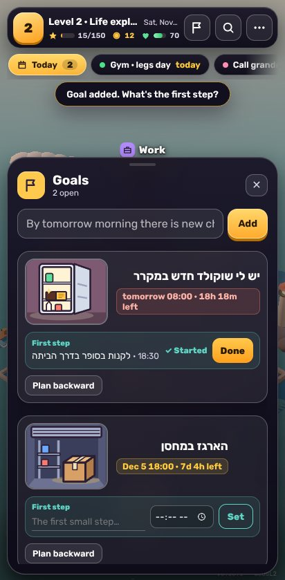

# Life Archipelago

A life organizer you play as a small 3D city. Each life area is a district, and each district shows at a glance what's late and what's done.

**▶ Open it: https://ranairan.github.io/byClaudePlatformPublic/** · **Android:** [Releases](https://github.com/ranAIran/byClaudePlatformPublic/releases) → `life-archipelago.apk`


<p>
  
  
  
</p>

## What it does
- **Capture:** type, speak, photograph, scan or share into the bag. Hebrew and English become tasks with dates and places.
- **Goals:** the flag button. Write what will be true and by when, then plan it backward. See the [manual](life/docs/goals-manual.html).
- **Your data stays yours:** it's kept on the device, with a full action log. Optional end-to-end encrypted sync between phone and computer (menu → Sync & devices).

## Develop
```bash
cd life && npm install
npm test              # unit tests
npm run test:visual   # browser checks with screenshots
```
Every push to `claude/life-archipelago` runs the tests and publishes the APK. Notes for contributors and AI sessions: [`CLAUDE.md`](CLAUDE.md).
